 

---

## ✨ Tentang

Aplikasi pencatatan keuangan **mobile-first** berformat Rupiah (`Rp1.000.000`), dengan pelacakan **8 pilar finansial**, tampilan ungu-navy bergaya kaca (*frosted glass*), penyimpanan lokal aman, dan dukungan **offline penuh**.

## 📊 5 Pilar Finansial

| Pilar | Rumus |
|---|---|
| 🟣 **Income Konsisten** | Rata-rata profit (finis − modal) 4 minggu terakhir ÷ target income per minggu |
| 🟢 **Kebutuhan Tercukupi** | Rata-rata kebutuhan terpenuhi 4 minggu terakhir ÷ target kebutuhan mingguan |
| 🔵 **Pengeluaran Stabil** | 100 dikurangi koefisien variasi (CV) modal antar minggu |
| 🟠 **Lepas dari Gali Lubang** | Total bayar utang ÷ total utang |
| 🌸 **Tabungan** | Total disisihkan ÷ target tabungan |

Skor keseluruhan adalah rata-rata kelima pilar, ditambah **Rata-rata Grow** (persentase pertumbuhan `finis / modal − 1`).

## 📱 Fitur

<b>🚀 Alur buka aplikasi</b>

- **Splash / Loading:** animasi cincin ungu menggambar dirinya (*stroke-dashoffset*), nama aplikasi memudar masuk, transisi fade out.
- **Buat Profilmu:** saat pertama kali buka, isi nama, target tujuan, dan tanggal target. Data tersimpan di HP dan dimuat otomatis.

<b>🎨 Gaya desain</b>

- Latar gradasi ungu-navy (`#1d1850` → `#15132f` → `#0e0d22`) dengan aksen ungu kebiruan (`#7c6cf5` / `#8f81ff`).
- Kartu dan tombol semi-transparan (*glassmorphism*, `blur(12px)`), sudut melengkung 20–24px.
- Header profil dengan avatar lingkaran berpendar, level rank (`Lv.11 F-Rank`), dan sapaan waktu otomatis.
- Navigasi bawah melayang berbentuk pil gelap: **Beranda**, **Catat**, **Riwayat**, **Pengaturan**.

<b>🖼️ Background kustom</b>

- Foto, GIF, atau video, disimpan di **IndexedDB** sebagai Blob lokal (tidak membebani localStorage).
- Slider kelegapan lapisan (*overlay*) dan tingkat blur kartu kaca.
- Peringatan baterai untuk media video besar.

<b>💾 Backup & unduh mandiri</b>

- **Ekspor & Impor JSON:** cadangkan seluruh catatan dan target.
- **Unduh Paket Statis (ZIP):** tombol di menu Pengaturan.

---

*Selamat mengelola keuangan mingguan menuju target impianmu* 🚀

